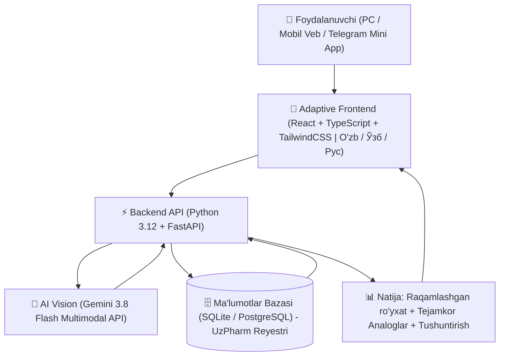

# 💊 DoriScan (Smart Farmatsevt)

> **"Retseptni skanerlang — 70% gacha tejang!"**  
> *Shifokor xatini o‘qiydi, ortiqcha xarajatdan saqlaydi.*

---

## 📌 Loyiha Haqida

**DoriScan** — shifokorlarning noaniq qo‘lyozma retseptlarini zamonaviy Multimodal AI (Vision) orqali soniyalar ichida raqamlashtiradigan, dorilarning vazifasini sodda tilda tushuntirib beradigan va eng muhimi, qimmat dori vositalarining arzon, sifatli mahalliy hamda xalqaro analoglarini (generiklarini) topib, foydalanuvchi byudjetini tejaydigan aqlli raqamli platforma (Telegram Mini App & Web).

---

## 🚀 Asosiy Imkoniyatlar (Core Features)

1. **AI Vision Skaner (Vrach xatini o'qish):** Shifokorning tushunarsiz qo'lyozmasini aniq tanish va raqamlashtirish.
2. **Sodda O'zbek Tili Tushuntirishi:** Dori nima maqsadda yozilgani, qanday ichilishi va qat'iy ogohlantirishlar.
3. **Byudjet Tejamkorligi (Analoglar Qidiruvi):** Kimyoviy ta'sir qiluvchi moddasi (Xalqaro Patentlanmagan Nomi — XPN) bir xil bo'lgan sertifikatlangan arzon muqobillarni topish va tejaladigan summani hisoblash.
4. **Geo-Dorixona:** Eng yaqin dorixonalardagi narx va mavjudlikni ko'rsatish, buyurtma berish.
5. **Dori Eslatmasi (Dori Qutisi):** Bemorlar va qariyalar uchun dori ichish vaqtini avtomatik eslatish.

---

## 🏗 Texnik Arxitektura (Tech Stack)



- **Frontend:** Adaptive Web + Telegram Mini App (React 19 / TypeScript / Vite / TailwindCSS / Lucide Icons)
- **Tillar:** O‘zbek (Lotin), Ўзбек (Кирилл), Русский
- **Backend:** Python 3.12+ / FastAPI / Pydantic v2 / SQLAlchemy
- **AI Core:** Google Gemini Multimodal Vision API (`gemini-3.8-flash` via `google-genai >= 2.30.1`)
- **Database:** SQLite (MVP) / PostgreSQL (Davlat Farmatsevtika reyestri, XPN bo‘yicha bog‘lanmalar)
- **Deployment:** Docker, Nginx, Cloud VPS

---

## 📂 Loyiha Tuzilmasi

```text
DoriScan/
├── backend/                  # FastAPI backend server
│   ├── app/
│   │   ├── api/              # API endpoints (retsept, dorilar, dorixonalar)
│   │   ├── core/             # Sozlamalar va xavfsizlik
│   │   ├── services/         # Gemini AI Vision va tahlil logikasi
│   │   ├── models/           # DB modellari (SQLAlchemy)
│   │   └── schemas/          # Pydantic schemalari
│   ├── data/                 # O'zbekiston dori vositalari bazasi (UzPharm)
│   ├── requirements.txt      # Python kutubxonalari
│   └── main.py               # Asosiy ishga tushirish fayli
├── frontend/                 # Telegram Mini App (React + Vite)
│   ├── src/
│   │   ├── components/       # Kamera, Skaner, Retsept kartasi, Analoglar
│   │   ├── pages/            # Bosh sahifa, Natijalar, Dorixona, Profil
│   │   └── api/              # Backend bilan integratsiya
│   └── package.json
├── docs/                     # Loyiha hujjatlari va tahlillar
│   └── PROJECT_BLUEPRINT.md  # To'liq biznes va texnik blueprint
└── README.md
```

---

## 💰 Monetizatsiya Modeli

1. **B2B Farmatsevtika Reklamasi:** Mahalliy sertifikatlangan zavodlar (Jurabek, Dentafill, Nobel, Radiks) dori analoglari ro'yxatida yuqori o'rinda tavsiya etilishi.
2. **Dorixona Komissiyasi (Lead Generation):** Har bir dori buyurtmasi yoki bron qilinishidan 5-10% komissiya.
3. **Agregator & Yetkazib Berish:** Yandex Delivery / kuryerlik orqali dorilarni eshikkacha yetkazish.
4. **Premium Obuna:** Dori qutisi, eslatmalar, oilaviy retseptlar arxivi uchun oylik qulay to'lov.

---

## ⚖️ Yuridik Ogohlantirish (Medical Disclaimer)

> **Diqqat:** DoriScan — sun'iy intellektga asoslangan axborot beruvchi intellektual tizimdir. Ushbu platforma tibbiy tashxis qo'ymaydi. Har qanday dori vositalarini yoki ularning analoglarini qabul qilishdan oldin davolovchi shifokor yoki malakali farmatsevt bilan maslahatlashing.
